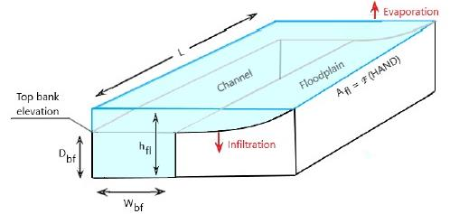
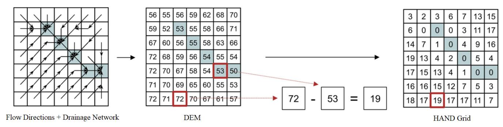
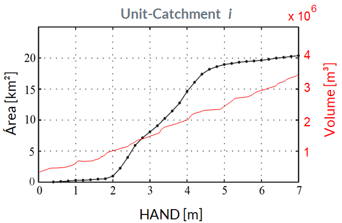

# Local-inertial routing

Local-inertial routing is the hydrodynamic option used when `routing_mode=1`.
It represents signed river discharge, backwater effects, and dynamic channel
and floodplain storage. The [River routing overview](river-routing.md)
describes the common network context and reference discharge.

## Local-inertial basis

The one-dimensional Saint-Venant equations for cross-sectional area $A$,
discharge $Q$, lateral inflow per unit length $q_l$, water depth $h$, bed slope
$S_0$, and friction slope $S_f$ are

$$
\frac{\partial A}{\partial t}+\frac{\partial Q}{\partial x}=q_l,
$$

$$
\frac{\partial Q}{\partial t}
+\frac{\partial(Q^2/A)}{\partial x}
+gA\frac{\partial h}{\partial x}
=gAS_0-gAS_f.
$$

The local-inertial approximation omits the advective momentum term
$\partial(Q^2/A)/\partial x$ but retains local acceleration, the water-surface
gradient, and Manning friction. The channel is treated as rectangular, and
hydraulic radius is approximated by depth.

*Channel and floodplain geometry used by the local-inertial representation.
Adapted from Collischonn et al. (2020).*

## Staggered numerical scheme

Water depth $h_i$, bed elevation $z_i$, water-surface elevation
$y_i=z_i+h_i$, stored volume, and flooded area are associated with catchment
centers. Discharge is evaluated at the connection to the downstream catchment.

For an upstream catchment and its downstream neighbor, the effective flow
depth and water-surface slope are

$$
h_f=\max(y_{up},y_{down})-\max(z_{up},z_{down}),
$$

$$
S_y=-\frac{y_{up}-y_{down}}{\Delta x}.
$$

$h_f$ is constrained to be nonnegative. For internal connections,
$\Delta x$ and channel width $B_f$ are the respective averages of the two
catchments' lengths and widths. At the ordinary basin outlet, the upstream
catchment length and width are used.

Let $q^n=Q^n/B_f$ be discharge per unit width at the preceding inertial
substep. The update is

$$
q^{n+1}=\frac{q^n-g\Delta t_r h_fS_y}
{1+g\Delta t_r h_fn^2|q^n|/h_f^{10/3}},
\qquad Q^{n+1}=B_fq^{n+1}.
$$

Here $S_y$ is dimensionless, $q$ is in $\mathrm{m^2\,s^{-1}}$, $B_f$ and
$h_f$ are in metres, $\Delta t_r$ is in seconds, $n$ is the upstream
catchment's Manning roughness in $\mathrm{s\,m^{-1/3}}$, and $g$ is the
configured gravitational acceleration in $\mathrm{m\,s^{-2}}$.

When $h_f=0$, discharge is set to zero. The result is also limited to the
subcritical range

$$
-B_fh_f^{3/2}\sqrt{9.81}\leq Q^{n+1}\leq B_fh_f^{3/2}\sqrt{9.81}.
$$

This limiter is part of the current solver in addition to the basic
local-inertial equation.

## Stability-controlled timestep

The explicit solver selects a candidate timestep independently for each
enabled catchment:

$$
\Delta t_i=\alpha\frac{1000L_i}{\sqrt{g\max(h_i,0.001)}},
$$

where $L_i$ is in kilometres, $h_i$ is in metres, and $\alpha$ is the
configured Courant factor. The routing timestep is

$$
\Delta t_r=\min\left(\Delta t_{model},\min_i\Delta t_i\right),
$$

then shortened on the final substep so the sum of routing intervals equals
the meteorological timestep exactly. The current code therefore takes the
minimum of catchment-specific length/depth criteria.

## River and floodplain continuity

Let $V_i$ be channel-plus-floodplain water volume in cubic metres. Horizontal
flow into catchment $i$ combines upstream river discharge, catchment lateral
inflow $Q_{lat}$, outgoing discharge, and optional net face exchange:

$$
Q_{net}=\sum Q_{up}+Q_{lat}-Q_{out}+Q_{face}.
$$

Precipitation $P$, open-water evaporation $E_w$, and floodplain infiltration
$D_{inf,f}$ are depths in millimetres per meteorological timestep. $P$ is the
post-interception value retained from the last active HRU processed in the
catchment, which is the literal current implementation. Applied over flooded
area $A_f$ in square kilometres during one inertial substep, the volume update
is

$$
V_i'=V_i+\Delta t_rQ_{net}
-\left(E_w+D_{inf,f}-P\right)
\frac{\Delta t_r}{\Delta t_{model}}
\frac{10^6A_f}{1000}.
$$

Volume is constrained to be nonnegative. The factor $10^6/1000$ converts a
millimetre over a square kilometre to cubic metres. The resulting volume is
converted back to stage and flooded area before the next inertial substep.

`Q_face` belongs to the pseudo-two-dimensional lateral-connection path. That
path remains in the source, but the current configuration reader always
disables it, so $Q_{face}=0$ for runs exposed through `config.nml`.

## Stage-area-volume representation

Floodplain geometry is prepared from relative elevations and inundated areas,
commonly obtained with the Height Above Nearest Drainage (HAND) terrain
descriptor.

*Conceptual construction of a HAND grid from terrain and drainage directions.
Adapted from Collischonn et al. (2020) and Rennó et al. (2008).*

*Example stage-area and stage-volume information for one catchment. Adapted
from Collischonn et al. (2020).*

At runtime, the first table interval represents the rectangular channel from
its bed to bankfull depth. Floodplain volumes are then integrated from the
input area/elevation points with the trapezoidal rule. Between tabulated
volumes, both stage and flooded area are linearly interpolated in volume space.

Above the final table volume, flooded area is held at its last value and stage
increases as

$$
y=y_{max}+\frac{V-V_{max}}{10^6A_{max}}.
$$

This extrapolation is intentional and is also used for reservoir-like water
bodies represented by these tables.

## Initial and downstream boundary conditions

Local-inertial discharge is initialized to $Q_0$, not to zero. For channel
width $B$ in metres, river slope $S_0$ in metres per metre, and Manning
roughness $n$ in $\mathrm{s\,m^{-1/3}}$, the initial depth is

$$
h^0=\frac{
\left(\dfrac{nB^{2/3}}{\sqrt{S_0}}\right)^{0.6}Q_0^{0.6}
}{B}+10^{-5}.
$$

$h^0$ is in metres. For reach length $L$ in kilometres, the initial
rectangular-channel volume is

$$
V^0=h^0B(1000L),
$$

in cubic metres. The initializer sets current flooded area to the greater of
the area interpolated at $V^0$ and the entire catchment area. Thus, in the
usual case, the first terrestrial balance starts with the whole catchment
marked as flooded; after the first inertial continuity update, flooded area is
instead the interpolated value capped at catchment area. This literal
implementation detail can affect the first timestep.

A requested hotstart is loaded after the initializers and replaces their
state, including the flooded-area state.

At an ordinary local-inertial outlet:

- a positive configured `downstream_boundary_slope` is converted from metres
  per kilometre to metres per metre and used to extend bed and water-surface
  elevation downstream;
- a zero or negligible configured slope uses a fixed downstream water level at
  the upstream catchment's bankfull elevation; and
- a reservoir-dam marker uses a fixed fall of $0.1\ \mathrm{m\,km^{-1}}$.

When reservoir outflow substitution is active, target discharge is interpolated
over the inertial substeps at the existing routing point, and reservoir volume
may be capped at the bankfull-channel table volume after its configured start
timestep.
