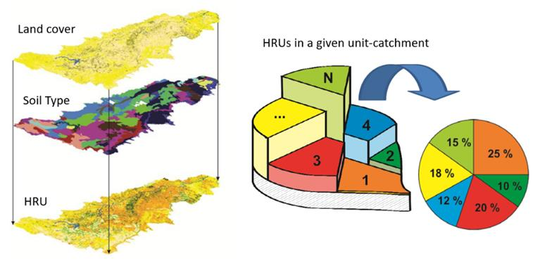

# Model concepts and discretization

MGB is a distributed large-basin hydrological model. It represents the land
surface with conceptual water and energy balances and represents flow along
the main drainage network with physically based or hydrological routing. The
model can be applied from basins of several thousand square kilometres to
continental domains, provided that the input data have already been prepared
at the model's spatial units.

This page introduces the conceptual model behind the current executable. It
describes the current source's names and implementation details. See
[References](references.md) for background publications and source
material.

## Three process levels

The calculation can be understood as three connected levels:

1. **Land-surface water and energy balance.** For every hydrological response
   unit (HRU) in a catchment, the model calculates radiation,
   evapotranspiration, interception, soil-water storage, and generated
   surface, subsurface, and groundwater flow.
2. **Flow within the catchment.** The three generated flow components are
   delayed in separate linear reservoirs and combined into the lateral inflow
   delivered to the explicitly represented river.
3. **Flow through the drainage network.** River discharge is routed from one
   catchment to the next with either Muskingum-Cunge or the local-inertial
   method. The local-inertial method also couples river storage to floodplain
   area, infiltration, precipitation, and open-water evaporation.

These levels are evaluated inside the meteorological timestep. The exact
ordering is part of the model's numerical behavior and is summarized in
[Model processes and numerical assumptions](model-processes.md).

## Catchments and river reaches

The basic spatial unit is the **catchment**, called a *minibacia* in Portuguese
hydrology. A catchment is the immediate contributing area of one explicit river
segment. Its attributes include local and upstream drainage area, centroid,
channel geometry, slope, connectivity, and the proportions of its HRUs.

Every catchment has one downstream network index. Water generated on the land
surface first enters that catchment's main river segment and then moves
through the connected drainage network. The three linear reservoirs represent
smaller streams that are outside the explicit network.

The catchment discretization is prepared outside this executable. It normally
starts from a digital elevation model and a selected main drainage network.
Increasing the number of catchments adds spatial detail and computational cost.
Model accuracy also depends on reach lengths and network topology.

## Hydrological response units

A catchment can contain several land covers and soil types. MGB represents
this sub-catchment heterogeneity with **hydrological response units** (HRUs).
An HRU describes an area expected to respond similarly under the same soil
moisture and meteorological forcing. It is commonly derived by combining soil,
land-cover, vegetation, and sometimes terrain classes.

*HRU construction and representation as area fractions within a catchment.
Adapted from Collischonn et al. (2020).*

The model stores only the fraction of each catchment occupied by each HRU; it
does not retain the HRU's position or shape inside the catchment. For
catchment $i$ with $N_u$ HRUs, the input percentages $f_{i,j}$ must satisfy

$$
\sum_{j=1}^{N_u} f_{i,j} = 100\%.
$$

The land-surface balance is evaluated independently for every non-negligible
pair $(i,j)$. HRU depths and fluxes are then aggregated with the area fraction
$f_{i,j}/100$. Thus two separated polygons belonging to the same HRU in one
catchment share a single modeled state.

An HRU with maximum soil-water storage close to zero is treated as open water.
When local-inertial routing is selected, the static-input preparation removes
the water-HRU fraction and redistributes it proportionally among the remaining
HRUs because open water is represented dynamically by the river-floodplain
storage.

## Subbasins and climate regions

**Subbasins** group neighboring catchments. Soil and terrestrial routing
parameters are indexed by subbasin and HRU, allowing regional parameter sets
without assigning an independent set to every catchment. The configured first
and last subbasin also select the part of the domain advanced by the current
run.

Subbasins are not another routing layer: network connectivity remains defined
between catchments. Their main role is parameter regionalization and run
selection. A subbasin partition should therefore reflect hydrological
information not already represented by the HRUs, while avoiding unnecessary
degrees of freedom.

Climate regions are a separate classification. They select the monthly
vegetation properties used by each catchment, including albedo, leaf-area
index, vegetation height, and minimum surface resistance.

## Spatial and temporal hierarchy

The central model dimensions correspond to:

| Dimension | Meaning | Main use |
| --- | --- | --- |
| Timestep | Meteorological interval | Advances forcing, state, and output |
| Catchment | Local contributing area and river segment | Aggregates HRUs and defines network connectivity |
| HRU | Hydrologically similar land fraction | Evaluates the vertical water and energy balance |
| Subbasin | Group of catchments | Selects regional soil and routing parameters |
| Climate region | Group sharing vegetation seasonality | Selects monthly vegetation parameters |

Conceptually, each model timestep contains an HRU loop nested within a
catchment loop, followed by network routing over catchments. Routing may add
internal substeps: Muskingum-Cunge uses 24 substeps per meteorological step,
while local-inertial routing selects substeps from its stability condition.
The current implementation and its state flow are described in
[Execution and data flow](../architecture/execution-and-data-flow.md).
