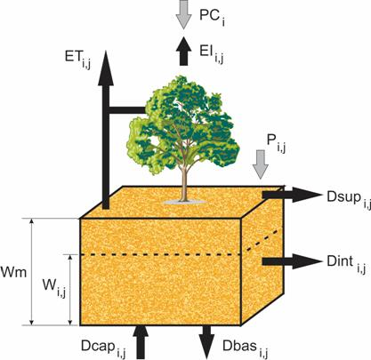

# Soil and catchment processes

The land-surface balance converts precipitation and evaporative demand into
changes in soil and interception storage and into three runoff components.
The calculation is independent for every HRU, after which the generated flows
are area-weighted and routed through three catchment-scale linear reservoirs.
The conceptual basis follows the ARNO/PDM variable-contributing-area approach,
Brooks-Corey drainage, and related MGB methods. The equations here match the
current `catchment` implementation. Background sources are listed in
[References](../project/references.md).

## Vertical water balance

*Water balance for one HRU. Symbols are defined below. Adapted from
Collischonn et al. (2020).*

For one HRU, let $W$ be soil-water storage and $W_m$ its maximum, both in
millimetres. All terms in the implemented update have already been converted
to depths over the model timestep:

$$
W' = W + P_l + D_{inf}+D_{cap}-E_s-D_{sup}-D_{int}-D_{bas}.
$$

Here:

| Symbol | Meaning |
| --- | --- |
| $P_l$ | Precipitation remaining after interception and flooded-area adjustment |
| $E_s$ | Soil and vegetation evapotranspiration |
| $D_{sup}$ | Rapid surface runoff |
| $D_{int}$ | Intermediate subsurface drainage |
| $D_{bas}$ | Slow percolation to the groundwater reservoir |
| $D_{cap}$ | Upward capillary return from groundwater |
| $D_{inf}$ | Infiltration from dynamically flooded area |

The terms are first estimated from storage at the beginning of the HRU
calculation. If the result exceeds $W_m$, the excess is added to surface
runoff. If the result is negative, the model reduces demand in this order:
soil evapotranspiration, groundwater percolation, subsurface drainage, and
surface runoff. The calculation repeats until storage is within its physical
bounds. This limiting order is part of the model behavior, not merely an
implementation convenience.

## Variable saturated area and surface runoff

The ARNO relationship describes the fraction $X$ of an HRU whose local
storage capacity is saturated at mean storage $W$:

$$
X=1-\left(1-\frac{W}{W_m}\right)^{b/(b+1)},
$$

where $b$ is the dimensionless shape parameter. Larger $b$ values generally
produce more surface runoff from smaller rainfall events because a larger
fraction of the HRU is represented as locally saturated.

Let $P_i$ be precipitation remaining after interception but before any
flooded-area adjustment. For $P_i>0$, the implementation first evaluates

$$
A=\left(1-\frac{W}{W_m}\right)^{1/(b+1)}
-\frac{P_i}{(b+1)W_m}.
$$

Surface runoff is then

$$
D_{sup}=
\begin{cases}
\max[P_i-(W_m-W),0], & A\leq0,\\
\max[P_i-(W_m-W)+W_mA^{b+1},0], & A>0.
\end{cases}
$$

When $P_i\leq0$, $D_{sup}=0$. The first branch represents rainfall sufficient
to saturate the storage distribution; the second integrates runoff from only
the saturated fraction.

## Groundwater percolation

The soil threshold used for groundwater generation is

$$
W_{bas}=w_cW_m,
$$

where $w_c$ is the fractional threshold read from `soil.par`. The executable
limits $w_c$ to a maximum of 0.1 before using it. The daily percolation rate is

$$
d_{bas}=
\begin{cases}
K_{bas}\dfrac{W-W_{bas}}{W_m-W_{bas}}, & W\geq W_{bas},\\
0, & W<W_{bas},
\end{cases}
$$

where $K_{bas}$ is in millimetres per day. The timestep depth is
$D_{bas}=d_{bas}\Delta t/86400$.

## Capillary return

The same threshold is used to activate upward capillary flow:

$$
W_{cap}=w_cW_m,
$$

$$
d_{cap}=\max\left[
CAP\frac{W_{cap}-W}{W_{cap}},0
\right],
$$

where $CAP$ is the maximum daily capillary flux from `soil.par`. The depth
added to the soil is $D_{cap}=d_{cap}\Delta t/86400$. After the HRU fluxes are
aggregated, the corresponding volume is removed from the catchment
groundwater reservoir and that reservoir is prevented from becoming negative.

## Subsurface drainage

The current executable uses the groundwater threshold for subsurface drainage
as well, so $W_{int}=W_{bas}$. With Brooks-Corey pore-size index $\lambda$ and
saturated subsurface conductivity $K_{int}$,

$$
d_{int}=
\begin{cases}
K_{int}\left(\dfrac{W-W_{int}}{W_m-W_{int}}\right)^{3+2/\lambda},
& W>W_{int},\\
0, & W\leq W_{int}.
\end{cases}
$$

Before conversion to the timestep depth, the rate is constrained numerically
to $0\leq d_{int}\leq W/10$. Although $W/10$ is formed directly from storage
in millimetres, the source treats that number as the upper daily rate. The
final depth is $D_{int}=d_{int}\Delta t/86400$.

## Floodplain infiltration and land-area adjustment

Floodplain infiltration is active only with local-inertial routing. Let
$A_f$ be the current flooded area and $A_c$ the catchment area, both in square
kilometres. The implemented daily infiltration rate is

$$
d_{inf}=\frac{A_f}{A_c}K_{inf,eff}
\left(1-\frac{W}{W_m}\right),
$$

with

$$
K_{inf,eff}=\min(K_{int},20\ \mathrm{mm\,day^{-1}}).
$$

The current calculation overwrites the `Kinf` value read from `soil.par` with
this effective rate.

The timestep depth is $D_{inf}=d_{inf}\Delta t/86400$. At the same time, the
initial ARNO surface runoff $D_{sup}^{*}$, post-interception precipitation
$P_i$, and soil-evapotranspiration terms are multiplied by the non-flooded
fraction

$$
f_{land}=\frac{\max(A_c-A_f,0)}{A_c}.
$$

Thus the depths entering the soil balance are

$$
P_l=f_{land}P_i,
\qquad
D_{sup}=f_{land}D_{sup}^{*},
\qquad
E_s=f_{land}E_s^{*}.
$$

This prevents the same flooded area from participating simultaneously in the
terrestrial balance and the open-water balance. $D_{inf}$ above is a depth
over the whole catchment for one HRU. Before the river continuity calculation,
the implementation converts it to a depth over the flooded area and aggregates
the HRUs:

$$
D_{inf,f}=\sum_j
D_{inf,j}\frac{f_j}{100}\frac{A_c}{A_f}.
$$

Here $D_{inf,f}$ is the floodplain depth in millimetres per model timestep and
$f_j$ is the HRU percentage. Multiplication by $A_f$ in the river balance then
removes the same volume that was added to HRU soil storage. The current
inertial initializer keeps $A_f$ nonzero; subsequent routing constrains it to
the catchment area.

## From HRU depth to catchment discharge

For a generated depth $D_j$ in HRU $j$, catchment area $A_c$ in square
kilometres, HRU percentage $f_j$, and timestep $\Delta t$ in seconds, the
inflow to the corresponding linear reservoir is

$$
q_j=\frac{1000D_jA_c(f_j/100)}{\Delta t}.
$$

The factor 1000 follows from $1\ \mathrm{mm}$ over
$1\ \mathrm{km^2}=1000\ \mathrm{m^3}$. The inflows are summed over HRUs for
surface, subsurface, and groundwater flow.

## Linear-reservoir routing

*Every catchment has one reservoir for each generated-flow pathway,
independent of its number of HRUs. Adapted from Collischonn et al. (2020).*

The three reservoirs represent travel time through smaller streams, shallow
soil pathways, and groundwater before water reaches the explicit river. They
are mathematical routing stores and do not represent dams or lakes.

The catchment time of concentration is calculated from the longest internal
reach length $L$ in kilometres and its elevation difference $\Delta H$ in
metres:

$$
T_c=3600\left(\frac{0.868L^3}{\Delta H}\right)^{0.385}.
$$

The source obtains $\Delta H$ by multiplying the input longest-reach slope by
$L$. The reservoir delays are

$$
T_{sup}=C_S T_c,
\qquad
T_{int}=C_I T_c,
\qquad
T_{bas}=3600C_B.
$$

$C_S$ and $C_I$ are dimensionless multipliers; $C_B$ is read in hours. For
reservoir storage $V_x$ in cubic metres, the outgoing discharge is

$$
Q_x=\frac{V_x}{T_x},
\qquad x\in\{sup,int,bas\}.
$$

Generated HRU volumes are added before this discharge is evaluated. The
storage update is $V_x'=V_x-Q_x\Delta t$. If that result would be negative,
the model releases the available volume over the timestep and sets storage to
zero. The lateral inflow delivered to river routing is

$$
Q_{lat}=Q_{sup}+Q_{int}+Q_{bas}.
$$

Catchment-mean soil storage and maximum storage are separately accumulated as
HRU-weighted depths. Reported soil saturation is the ratio of those two
weighted means, not the mean of individual HRU saturation ratios.
